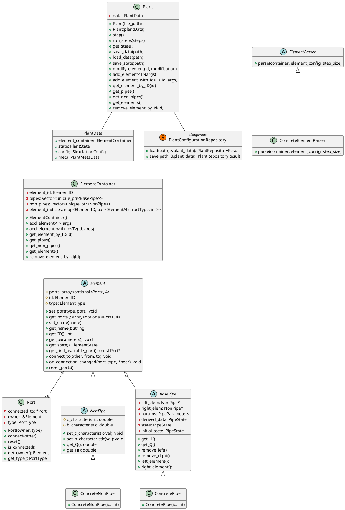

# LVTrans-

Modern LVTrans written in C++.

## Requirements

The plant should be able to:

| Done | Requirement                                                     | Designed in architecture? | Notes                                           |
| ---- | --------------------------------------------------------------- | ------------------------- | ----------------------------------------------- |
| [x]  | Load existing plant from file                                   | OK                        |                                                 |
| [x]  | Save plant to file                                              | OK                        |                                                 |
| [x]  | Step simulation                                                 | OK                        |                                                 |
| [x]  | Step simulation _N_ times                                       | OK                        |                                                 |
| [ ]  | Run simulation continuously                                     | OK                        | Maybe the client should be responsible instead? |
| [ ]  | Stop simulation                                                 | OK                        |                                                 |
| [ ]  | Pause simulation                                                | OK                        |                                                 |
| [ ]  | Resume simulation                                               | OK                        |                                                 |
| [x]  | Save current simulation state                                   | OK                        |                                                 |
| [x]  | Continue simulation from a loaded state                         | OK                        | Via constructor                                 |
| [ ]  | Read element outputs/state while the simulation is running      | OK                        | Via visitor pattern                             |
| [x]  | Change supported runtime inputs while the simulation is running | OK                        |                                                 |
| [ ]  | Expose simulation output independently of the user interface    |                           |                                                 |
| [ ]  | Support execution faster than real time                         | OK                        |                                                 |
| [ ]  | Support multiple independent simulation instances               | OK?                       |                                                 |

## Examples

_Load plant, step, step 100 times, and save plant along with the current state._

```cpp
int main(){
    Plant plant("example_plant.yaml");

    plant.step();

    plant.run_steps(100);

    plant.save("example_plant.yaml");
}
```

_Get a list of all the elements in the plant._
_Get an element by id and its state._

```cpp
int main(){
    Plant plant("example_plant.yaml");
    // std::variant ElementState<PipeState, ValveState, PumpState> state;

    std::vector<Element> elements = plant.get_elements();
    // expecting it to be pipe
    // get_element automatically dynamic_casts to the correct type
    Pipe& pipe1 = plant.get_element("pipe_1");

    // ElementStateVisitor? It knows how to talk to the element and get its state
    ElementVisitor state_visitor = new ElementStateVisitor();
    pipe1.accept(state_visitor); // Maybe print/draw to ui?


    Valve valve1 = plant.get_element("valve_1");
    ValveState valve1_state = valve1.get_state(); // ?

    // ...
```

_Run simulation continuously until stopped._ ??

```cpp
int main(){
    Plant plant("example_plant.yaml");

    plant.run_continuous(); // infinite loop until stopped?
}
```

_Change runtime element's parameters_

```cpp
int main(){
    Plant plant("example_plant.yaml");

    // modify element checks that
    // 1. the element exists given the id
    // 2. the combination of state type, modification type and modification value is valid for that element
    plant.modify_element(1, SetValveOpening{0.5});
    plant.modify_element(2, SetReservoirH0{100.0});
    plant.modify_element(3, SetPeltonInjector{.2});

    struct SetValveOpening {
        double opening;
    };
    struct SetReservoirH0 {
        double h0;
    };
    
    using ElementModification = std::variant<SetValveOpening, SetReservoirH0, SetPeltonInjector>;

    Plant::modify_element(int id, ElementModification mod) {
        auto element = get_element(id);
        if (!element) {
            return;
        }

        element->modify(mod);
    }

    virtual void modify(ElementModification mod) = 0;
    Pipe::modify(mod) {
        switch (mod) {
            case SetValveOpening:
                break;
            case SetPeltonInjector:
            case SetPeltonExtractor:
            case SetReservoirH0:
                break;
        }
    }
}
    

    
}
```

_Add and connect the existing elements_

```cpp
Plant plant(0.1);
auto* reservoir = plant.add_element<ConstantLevelLeft>(150.0).value();
auto* pipe = plant.add_element<Pipe>(PipeParameters{}, 0.1).value();
auto* valve = plant.add_element<Valve>(ValveParameters{}).value();

HydraulicConnections::connect(*pipe, PipeEnd::Left, *reservoir);
HydraulicConnections::connect(*pipe, PipeEnd::Right, *valve);
// R <--> P <--> V

// A non-pipe can also have all its connections removed:
HydraulicConnections::disconnect_all(*valve);
// R <--> P --> X   
```

_Read an elements state during simulation_
```cpp

    using ElementStateValue = std::pair<std::string, double>;
    struct ElementView {
        ElementID id; 
        double value;
    }
    Plant plant;
    
    plant.add_element<Pipe>(PipeParameters {...});


    plant.step();

    ElementState state = plant.read_state(1);

    
```

## System Architecture (WIP)


