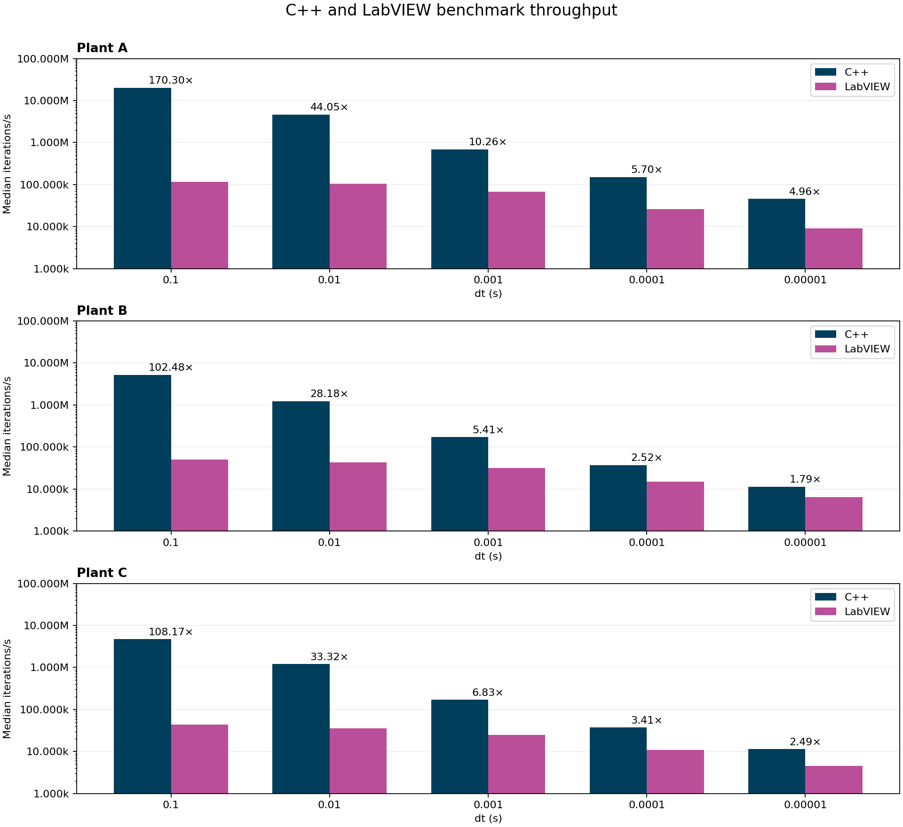

# C++ and LabVIEW plant benchmarks

Throughput is the median of `IterationsPerSecond`.



| Plant | dt (s) | C++ (iterations/s) | LabVIEW (iterations/s) | C++ speedup | Samples used (C++ / LV) | Paired plot |
|---|---:|---:|---:|---:|---:|---|
| A | 0.1 | 19.957M | 117.189k | 170.30× | 30 / 30 | [Plot](plantA/plantA_dt_0.1_comparison.png) |
| A | 0.01 | 4.607M | 104.583k | 44.05× | 29 / 29 | [Plot](plantA/plantA_dt_0.01_comparison.png) |
| A | 0.001 | 692.161k | 67.487k | 10.26× | 29 / 29 | [Plot](plantA/plantA_dt_0.001_comparison.png) |
| A | 0.0001 | 150.423k | 26.375k | 5.70× | 29 / 29 | [Plot](plantA/plantA_dt_0.0001_comparison.png) |
| A | 0.00001 | 45.693k | 9.216k | 4.96× | 30 / 29 | [Plot](plantA/plantA_dt_0.00001_comparison.png) |
| B | 0.1 | 5.232M | 51.048k | 102.48× | 54 / 29 | [Plot](plantB/plantB_dt_0.1_comparison.png) |
| B | 0.01 | 1.231M | 43.692k | 28.18× | 29 / 29 | [Plot](plantB/plantB_dt_0.01_comparison.png) |
| B | 0.001 | 172.686k | 31.919k | 5.41× | 29 / 29 | [Plot](plantB/plantB_dt_0.001_comparison.png) |
| B | 0.0001 | 37.550k | 14.915k | 2.52× | 29 / 31 | [Plot](plantB/plantB_dt_0.0001_comparison.png) |
| B | 0.00001 | 11.483k | 6.423k | 1.79× | 28 / 31 | [Plot](plantB/plantB_dt_0.00001_comparison.png) |
| C | 0.1 | 4.696M | 43.411k | 108.17× | 29 / 39 | [Plot](plantC/plantC_dt_0.1_comparison.png) |
| C | 0.01 | 1.196M | 35.903k | 33.32× | 29 / 48 | [Plot](plantC/plantC_dt_0.01_comparison.png) |
| C | 0.001 | 169.372k | 24.787k | 6.83× | 31 / 40 | [Plot](plantC/plantC_dt_0.001_comparison.png) |
| C | 0.0001 | 37.206k | 10.925k | 3.41× | 29 / 38 | [Plot](plantC/plantC_dt_0.0001_comparison.png) |
| C | 0.00001 | 11.364k | 4.567k | 2.49× | 27 / 40 | [Plot](plantC/plantC_dt_0.00001_comparison.png) |

## Individual runs and source data

- Plant A, dt = 0.1, C++: [plot](plantA/bench_results_A_dt_0.1.png), [source](../../benchmark_data/plantA/bench_results_A_dt_0.1.csv)
- Plant A, dt = 0.1, LabVIEW: [plot](plantA/bench_results_A_LabVIEW_dt_0.1.png), [source](../../benchmark_data/plantA/bench_results_A_LabVIEW_dt_0.1.csv)
- Plant A, dt = 0.01, C++: [plot](plantA/bench_results_A_dt_0.01.png), [source](../../benchmark_data/plantA/bench_results_A_dt_0.01.csv)
- Plant A, dt = 0.01, LabVIEW: [plot](plantA/bench_results_A_LabVIEW_dt_0.01.png), [source](../../benchmark_data/plantA/bench_results_A_LabVIEW_dt_0.01.csv)
- Plant A, dt = 0.001, C++: [plot](plantA/bench_results_A_dt_0.001.png), [source](../../benchmark_data/plantA/bench_results_A_dt_0.001.csv)
- Plant A, dt = 0.001, LabVIEW: [plot](plantA/bench_results_A_LabVIEW_dt_0.001.png), [source](../../benchmark_data/plantA/bench_results_A_LabVIEW_dt_0.001.csv)
- Plant A, dt = 0.0001, C++: [plot](plantA/bench_results_A_dt_0.0001.png), [source](../../benchmark_data/plantA/bench_results_A_dt_0.0001.csv)
- Plant A, dt = 0.0001, LabVIEW: [plot](plantA/bench_results_A_LabVIEW_dt_0.0001.png), [source](../../benchmark_data/plantA/bench_results_A_LabVIEW_dt_0.0001.csv)
- Plant A, dt = 0.00001, C++: [plot](plantA/bench_results_A_dt_0.00001.png), [source](../../benchmark_data/plantA/bench_results_A_dt_0.00001.csv)
- Plant A, dt = 0.00001, LabVIEW: [plot](plantA/bench_results_A_LabVIEW_dt_0.00001.png), [source](../../benchmark_data/plantA/bench_results_A_LabVIEW_dt_0.00001.csv)
- Plant B, dt = 0.1, C++: [plot](plantB/bench_results_B_dt_0.1.png), [source](../../benchmark_data/plantB/bench_results_B_dt_0.1.csv)
- Plant B, dt = 0.1, LabVIEW: [plot](plantB/bench_results_B_LabVIEW_dt_0.1.png), [source](../../benchmark_data/plantB/bench_results_B_LabVIEW_dt_0.1.txt)
- Plant B, dt = 0.01, C++: [plot](plantB/bench_results_B_dt_0.01.png), [source](../../benchmark_data/plantB/bench_results_B_dt_0.01.csv)
- Plant B, dt = 0.01, LabVIEW: [plot](plantB/bench_results_B_LabVIEW_dt_0.01.png), [source](../../benchmark_data/plantB/bench_results_B_LabVIEW_dt_0.01.txt)
- Plant B, dt = 0.001, C++: [plot](plantB/bench_results_B_dt_0.001.png), [source](../../benchmark_data/plantB/bench_results_B_dt_0.001.csv)
- Plant B, dt = 0.001, LabVIEW: [plot](plantB/bench_results_B_LabVIEW_dt_0.001.png), [source](../../benchmark_data/plantB/bench_results_B_LabVIEW_dt_0.001.txt)
- Plant B, dt = 0.0001, C++: [plot](plantB/bench_results_B_dt_0.0001.png), [source](../../benchmark_data/plantB/bench_results_B_dt_0.0001.csv)
- Plant B, dt = 0.0001, LabVIEW: [plot](plantB/bench_results_B_LabVIEW_dt_0.0001.png), [source](../../benchmark_data/plantB/bench_results_B_LabVIEW_dt_0.0001.txt)
- Plant B, dt = 0.00001, C++: [plot](plantB/bench_results_B_dt_0.00001.png), [source](../../benchmark_data/plantB/bench_results_B_dt_0.00001.csv)
- Plant B, dt = 0.00001, LabVIEW: [plot](plantB/bench_results_B_LabVIEW_dt_0.00001.png), [source](../../benchmark_data/plantB/bench_results_B_LabVIEW_dt_0.00001.txt)
- Plant C, dt = 0.1, C++: [plot](plantC/bench_results_C_dt_0.1.png), [source](../../benchmark_data/plantC/bench_results_C_dt_0.1.csv)
- Plant C, dt = 0.1, LabVIEW: [plot](plantC/bench_results_LabVIEW_C_dt_0.1.png), [source](../../benchmark_data/plantC/bench_results_LabVIEW_C_dt_0.1.csv)
- Plant C, dt = 0.01, C++: [plot](plantC/bench_results_C_dt_0.01.png), [source](../../benchmark_data/plantC/bench_results_C_dt_0.01.csv)
- Plant C, dt = 0.01, LabVIEW: [plot](plantC/bench_results_LabVIEW_C_dt_0.01.png), [source](../../benchmark_data/plantC/bench_results_LabVIEW_C_dt_0.01.csv)
- Plant C, dt = 0.001, C++: [plot](plantC/bench_results_C_dt_0.001.png), [source](../../benchmark_data/plantC/bench_results_C_dt_0.001.csv)
- Plant C, dt = 0.001, LabVIEW: [plot](plantC/bench_results_LabVIEW_C_dt_0.001.png), [source](../../benchmark_data/plantC/bench_results_LabVIEW_C_dt_0.001.csv)
- Plant C, dt = 0.0001, C++: [plot](plantC/bench_results_C_dt_0.0001.png), [source](../../benchmark_data/plantC/bench_results_C_dt_0.0001.csv)
- Plant C, dt = 0.0001, LabVIEW: [plot](plantC/bench_results_LabVIEW_C_dt_0.0001.png), [source](../../benchmark_data/plantC/bench_results_LabVIEW_C_dt_0.0001.csv)
- Plant C, dt = 0.00001, C++: [plot](plantC/bench_results_C_dt_0.00001.png), [source](../../benchmark_data/plantC/bench_results_C_dt_0.00001.csv)
- Plant C, dt = 0.00001, LabVIEW: [plot](plantC/bench_results_LabVIEW_C_dt_0.00001.png), [source](../../benchmark_data/plantC/bench_results_LabVIEW_C_dt_0.00001.csv)

## Regenerate

```sh
python3 tools/visualizer/compare_plants.py
```
